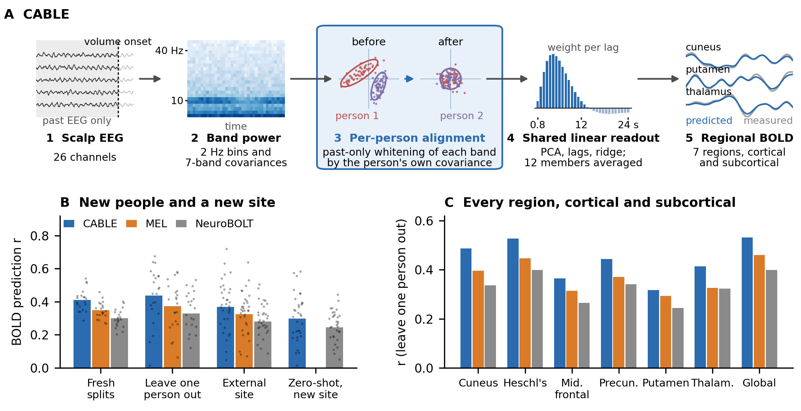
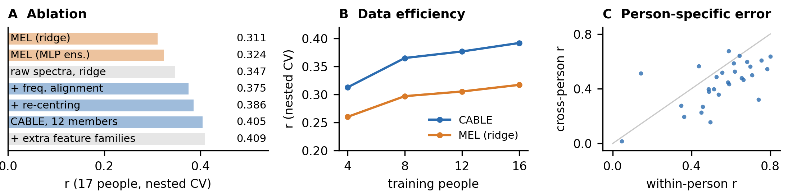

# CABLE: a linear model that outperforms state-of-the-art EEG-to-fMRI models on new subjects

CABLE (Causal Alignment of Band-Limited EEG) aligns each subject's EEG to its own running spatial covariance, so a ridge ensemble predicts regional BOLD in unseen subjects with no fMRI, labels or calibration, beating NeuroBOLT and MEL on the NeuroBOLT dataset and on the external OpenNeuro ds003768.

SUBMITTED [COSYNE 2027]

**Paper:** [`paper/CABLE_COSYNE2027.pdf`](paper/CABLE_COSYNE2027.pdf)

## Figures



**Figure 1.** **A** CABLE (schematic; traces illustrative). Step 3 aligns each subject's EEG to itself using past samples only, so one linear projection serves all subjects. **B** Prespecified comparisons on new subjects and a new site (bars: mean r; dots: individual splits, held-out subjects or external participants). **C** Accuracy per ROI, leaving one subject out (22 subjects, 29 scans).



**Figure 2.** **A** Development ablation (17 subjects, nested cross-validation; MEL in the same folds). **B** Data efficiency in development. **C** Per scan: within-person r (NeuroBOLT's intra-scan protocol) against cross-person r (subject never seen).

## Independent follow-up validation

An independent re-run (October 2026) reproduces CABLE's C1a/C1b scores and adds two tests; details,
caveats and file hashes are in [`FOLLOWUP.md`](FOLLOWUP.md) and [`followup/`](followup/).

| What | Test data | Mean r |
|---|---|---:|
| Original CABLE retrained from the pinned source (C1a) | NeuroBOLT, 22 people | 0.4381 |
| Offline variant (whole-recording normalization + future EEG; not online) | same 22 people | 0.4566 |
| CABLE trained on 22 people | independent cohort, 32 people | 0.3315 |
| Same CABLE trained on 66 people | same 32 people | 0.3688 |

The first two rows and the last two rows use different test sets and are not comparable with each other.
The feature pipeline is causal, but the scored ensemble z-scores each member's predictions over the whole
evaluated scan, so the reported scores are offline (see `FOLLOWUP.md`).

## Running the code

### What you need

- Python 3.10+ and a [Modal](https://modal.com) account. Every heavy step runs as a Modal app with its own pinned container image, so locally you only need:

  ```bash
  pip install -r requirements.txt
  modal setup                       # authenticate once
  modal volume create cable-data    # all intermediate data lives on this volume
  ```

- No data download by hand: the scripts fetch the public NeuroBOLT release (Hugging Face `NeurdyLab/NeuroBOLT`), OpenNeuro ds003768, the MNI template, NeuroBOLT's code and the LaBraM checkpoint inside their containers.
- Compute: the CABLE and MEL-ridge fits run on CPU. The NeuroBOLT re-runs (`b9nb*.py`), MEL-MLP (`b9mel.py`) and the LaBraM features (`b9fm.py`) use GPUs.

Run every command from the repository root.

### 1. NeuroBOLT dataset: download and features

```bash
modal run experiments/bridge009/b9nb.py::prepare        # NeuroBOLT EEG + DiFuMo-64 ROI series -> volume
modal run experiments/bridge005/b5feat.py::nb_only      # band power and regional targets on the 0.8 s grid
modal run experiments/bridge008/b8feat.py               # fine spectra (2 Hz bins, 1-45 Hz)
modal run experiments/bridge008/b8cov.py                # band-limited spatial covariances (4 bands)
modal run experiments/bridge008/b8cov7.py               # band-limited spatial covariances (7 bands)
modal run experiments/bridge009/b9cache.py              # aligned per-scan feature cache + targets
modal run experiments/bridge009/b9feat2.py              # strictly causal feature families used by CABLE
modal run experiments/bridge009/b9melfeat.py            # NeuroBOLT-exact TR targets and MEL tokens
```

### 2. Splits

The evaluation splits are committed (`experiments/bridge009/results/confirm_splits.json`, `c3_folds.json`).
`python experiments/bridge009/b9splits.py` regenerates `confirm_splits.json` deterministically.

### 3. New subjects (Fig. 1B fresh splits and leave-one-subject-out, Fig. 1C)

```bash
modal run experiments/bridge009/b9confirm.py --sets C1a,C1b --methods ours,mel_ridge,mel_mlp
modal run experiments/bridge009/b9nb.py --sets C1a,C1b  # NeuroBOLT's released code, unmodified (GPU)
modal run experiments/bridge009/b9c2.py                 # NeuroBOLT's intra-scan protocol (Fig. 2C)
```

### 4. External dataset ds003768 (Fig. 1B external site and zero-shot)

```bash
modal run experiments/bridge009/b9ext.py --stage eeg    # artifact cleaning, alignment to fMRI volumes
modal run experiments/bridge009/b9ext.py --stage fmri   # motion correction, registration, DiFuMo-64 ROI series
modal run experiments/bridge009/b9ext.py --stage feat   # CABLE / MEL features
modal run experiments/bridge009/b9c3.py                 # CABLE and MEL, subject-grouped CV + zero-shot
modal run experiments/bridge009/b9nb3.py --prep && modal run experiments/bridge009/b9nb3.py     # NeuroBOLT in-dataset
modal run experiments/bridge009/b9nbzs.py --prep && modal run experiments/bridge009/b9nbzs.py   # NeuroBOLT zero-shot
```

### 5. Data efficiency, development ablations, reverse direction

```bash
modal run experiments/bridge009/b9eff.py                # Fig. 2B
modal run experiments/bridge009/b9dev.py --batch k1     # nested LOSO over the 17 development subjects (Fig. 2A);
                                                        #   --batch picks a set of configs from BATCHES (k1: raw
                                                        #   spectra, fa / ea / ea2: alignment variants), --ens scores
                                                        #   an equal-weight ensemble of evaluated configs
modal run experiments/bridge009/b9mel.py                # MEL variants in the same folds
modal run experiments/bridge009/b9mlp.py                # nonlinear readouts: MLP
modal run experiments/bridge009/b9gbm.py                # nonlinear readouts: gradient-boosted trees
modal run experiments/bridge009/b9fm.py                 # frozen LaBraM embeddings as features (optional families:
                                                        #   b9feat3.py, b9phys.py)
modal run experiments/bridge008/b8rev.py                # fMRI -> EEG band power, leave one subject out
modal run experiments/reverse_controls/revctl.py        # global-signal controls and circular-shift null
```

The development ablation values plotted in Fig. 2A are recorded in `figures/make_fig_data.py`.

### 6. Scores, statistics and figures

Download NeuroBOLT's per-scan predictions from the volume so that files sit at
`experiments/bridge009/results/<dir>/<split>__<roi>.json`:

```bash
modal volume get cable-data bridge009/nb_confirm experiments/bridge009/results/nb_preds
modal volume get cable-data bridge009/nb_c3      experiments/bridge009/results/nb_c3_preds
modal volume get cable-data bridge009/nb_zs      experiments/bridge009/results/nb_zs_preds
```

Then:

```bash
python experiments/bridge009/b9analyze.py   # tables, paired sign-flip tests, CIs -> results/confirm_summary.json
python figures/make_fig_data.py             # -> figures/fig_data.json
python figures/plot_figures.py              # -> figures/figure1.png, figures/figure2.png
```

`figures/fig_data.json` is committed, so `python figures/plot_figures.py` works immediately and reproduces both figures
exactly. The score files behind the paper's numbers are committed under `experiments/bridge009/results/` and
`experiments/bridge008/results/`.

## Repository layout

```
paper/                      the submitted abstract (PDF)
figures/                    figures, the data behind them, and the scripts that draw them
experiments/bridge003-008/  shared library and NeuroBOLT feature extraction; reverse direction (b8rev.py)
experiments/bridge009/      CABLE (b9lib.py, b9confirm.py), MEL reimplementation, NeuroBOLT re-runs,
                            external dataset, analysis; results/ holds the scores used in the paper
experiments/reverse_controls/  controls for the fMRI -> EEG result
```

## Credits

Tejas Bharadwaj, Guhan Venkatachalapathi, Unnat Parsana
